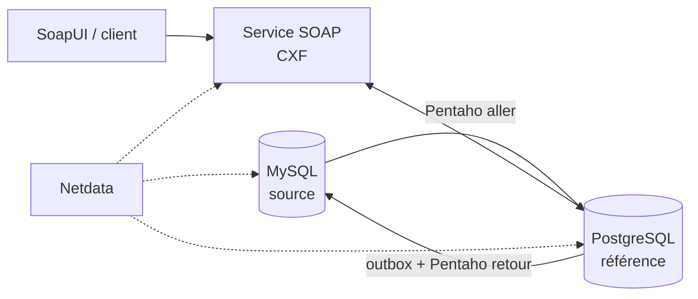

# Service SOAP de gestion des employés

Projet « Développement à base de composants et services web » 2026 – **Thème 4** – Filière SI, **Groupe 6**.

**Technologies :** Java 17, Apache CXF 4, Spring Boot 3, MySQL 8, PostgreSQL 16, Pentaho Data Integration, Netdata, SoapUI.

**Équipe :** NANA Abdoul Faycal · OUEDRAOGO Y. Ibrahim · KABORE Wend-Barka Boukary · TINDANO Fernand Amed · KOMPAORE Abdoul Malick ([répartition](docs/repartition.md))

## Ce que fait le projet

| Exigence de l'énoncé | Réalisation |
|---|---|
| 1. Modèle commun d'employé et base de référence | Même modèle dans MySQL, PostgreSQL et le WSDL ; **PostgreSQL est la base de référence** ([modèle](docs/modele-employe.md)) |
| 2. Synchroniser MySQL vers PostgreSQL avec Pentaho | Job `sync_mysql_to_pg.kjb` : nettoyage, normalisation, validation, rejets tracés, fusion « la plus récente gagne » |
| 3. getEmployeeDetails, createEmployee, updateEmployee | Service SOAP Apache CXF, approche contract-first |
| 4. Publier le WSDL et documenter les erreurs SOAP | `http://localhost:8080/services/EmployeeService?wsdl`, 4 Faults typés ([erreurs](docs/erreurs-soap.md)) |
| 5. Stratégie de retour vers MySQL | Outbox transactionnelle + job `sync_pg_to_mysql.kjb` ([stratégie](docs/strategie-synchronisation.md)) |
| 6. Netdata et test de bout en bout | Métriques système, MySQL, PostgreSQL et SOAP, alerte de disponibilité ([Netdata](docs/supervision-netdata.md)) ; `tests/e2e/e2e.sh` : 23/23 |

## Architecture



Détails : [docs/architecture.md](docs/architecture.md).

## Prérequis

| Outil | Version | Usage |
|---|---|---|
| Docker + Docker Compose | Docker 24+ | MySQL, PostgreSQL, service SOAP, Netdata |
| Pentaho Data Integration CE | 9.x ou 10.x (Java 11/17) | Jobs de synchronisation, [installation à part](pentaho/INSTALLATION.md) |
| Java + Maven | JDK 17+, Maven 3.9 | Seulement pour compiler/tester le service hors Docker |
| SoapUI | 5.7+ (ou Docker) | Tests SOAP |
| bash, curl | – | Scripts (sous Windows : Git Bash ou WSL) |

## Installation sur une machine neuve

> Sans Docker (Windows sans virtualisation, par exemple) : `./scripts/install-windows.sh` dans Git Bash installe et démarre tout automatiquement. Détails dans [docs/installation-windows.md](docs/installation-windows.md) ; installation testée de bout en bout (23/23).

```bash
git clone https://github.com/malickabdoul/employee-soap-servic.git employee-soap-service
cd employee-soap-service

# 1. Démarrer les bases, le service et Netdata (crée les schémas et les données fictives)
docker compose up -d --build
docker compose ps            # les 4 conteneurs doivent être "healthy" / "Up"

# 2. Installer Pentaho (voir pentaho/INSTALLATION.md), puis lancer la première synchronisation
export PDI_HOME=~/pentaho/data-integration
./scripts/run-sync.sh aller  # 20 employés chargés dans PostgreSQL, 3 rejetés

# 3. Vérifier le service
curl http://localhost:8080/services/EmployeeService?wsdl
```

| URL | Contenu |
|---|---|
| http://localhost:8080/services | Liste des services CXF |
| http://localhost:8080/services/EmployeeService?wsdl | Contrat WSDL |
| http://localhost:8080/actuator/health | État du service et de la base |
| http://localhost:8080/actuator/prometheus | Métriques (lues par Netdata) |
| http://localhost:19999 | Tableau de bord Netdata |

Comptes de démonstration (à changer en production) : MySQL `root/root_pwd`, `etl/etl_pwd` ; PostgreSQL `postgres/postgres_pwd`, `app/app_pwd`, `etl/etl_pwd`.

## Utilisation

Exemple d'appel (fichiers prêts dans `tests/requests/`) :

```bash
curl -H "Content-Type: text/xml;charset=UTF-8" \
     --data-binary @tests/requests/get-ok.xml \
     http://localhost:8080/services/EmployeeService
```

Synchronisations :

```bash
./scripts/run-sync.sh aller    # MySQL -> PostgreSQL
./scripts/run-sync.sh retour   # modifications SOAP -> MySQL
```

## Tests

```bash
cd service && mvn test && cd ..   # 15 tests JUnit (validation + appels SOAP réels sur base H2)
./scripts/run-soapui.sh           # projet SoapUI : 4 cas, 12 requêtes, 54 assertions
./tests/e2e/e2e.sh                # chaîne complète MySQL -> Pentaho -> PG -> SOAP -> Pentaho -> MySQL + Netdata
```

Résultats attendus et obtenus : [tests/resultats-attendus.md](tests/resultats-attendus.md).

## Contenu du dépôt

```
├── docker-compose.yml          MySQL, PostgreSQL, service SOAP, Netdata
├── db/mysql/                   schéma source + 23 employés fictifs (dont 3 invalides)
├── db/postgres/                schéma de référence, comptes, requête de fusion
├── pentaho/                    jobs .kjb et transformations .ktr + INSTALLATION.md
├── service/                    projet Maven Spring Boot + Apache CXF
│   └── src/main/resources/wsdl/EmployeeService.wsdl
├── netdata/                    collecteurs go.d et alerte
├── scripts/                    run-sync.sh, run-soapui.sh
├── tests/requests/             requêtes SOAP d'exemple
├── tests/soapui/               projet SoapUI + résultats
├── tests/e2e/                  test de bout en bout + journal de référence
├── docs/                       architecture, modèle, erreurs SOAP, synchronisation, Netdata, répartition
└── presentation/               présentation PowerPoint
```

## Arrêter et réinitialiser

```bash
docker compose down        # arrête
docker compose down -v     # arrête et supprime les données (les scripts db/ seront rejoués au prochain démarrage)
```
