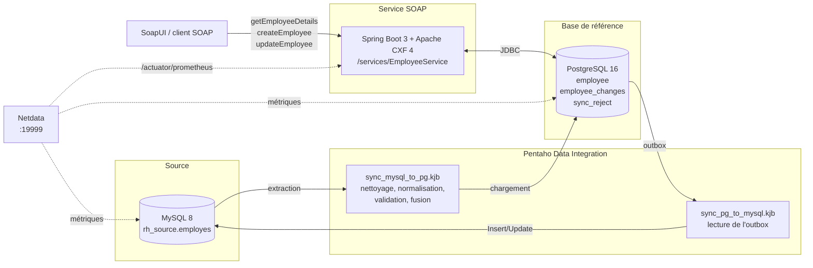

# Architecture

## Composants

| Composant | Technologie | Rôle |
|---|---|---|
| Base source | MySQL 8 (`es-mysql`, port 3306) | Historique RH, données fictives, reçoit les modifications SOAP en retour |
| ETL | Pentaho Data Integration 9.x (Kitchen/Spoon) | Synchronisation aller et retour |
| Base de référence | PostgreSQL 16 (`es-postgres`, port 5432) | Seule base lue et écrite par le service |
| Service SOAP | Java 17, Spring Boot 3.3, Apache CXF 4.0 (`es-service`, port 8080) | Contrat WSDL, 3 opérations, Faults |
| Supervision | Netdata (`es-netdata`, port 19999) | Métriques système, bases et service, alerte de disponibilité |
| Tests | JUnit 5, SoapUI 5.10, script bash | Unitaires, intégration SOAP, bout en bout |

## Organisation du code Java (`service/`)

| Paquet | Contenu |
|---|---|
| `ws.generated` | Classes générées depuis le WSDL par `cxf-codegen-plugin` (non versionnées) |
| `ws` | `EmployeeEndpoint` (implémentation du portType), conversion des types, intercepteur de faultcode |
| `service` | `EmployeeService` : règles métier et transactions (modification + outbox) |
| `domain` | Modèle, règles de validation, exceptions métier |
| `repository` | Accès JDBC à PostgreSQL |
| `config` | Publication de l'endpoint CXF, logs SOAP, métriques |

## Choix techniques

- **Contract-first** : le WSDL est écrit à la main et documenté ; le code Java en est généré. Le contrat publié sur `?wsdl` est exactement le fichier du dépôt.
- **JDBC simple** plutôt que JPA : les requêtes sont visibles et courtes, et la transaction modification + outbox est explicite.
- **Outbox transactionnelle** pour le retour vers MySQL : voir [strategie-synchronisation.md](strategie-synchronisation.md).
- **Zone de transit + fusion SQL** pour l'aller : permet d'appliquer la règle « la plus récente gagne » dans PostgreSQL.
