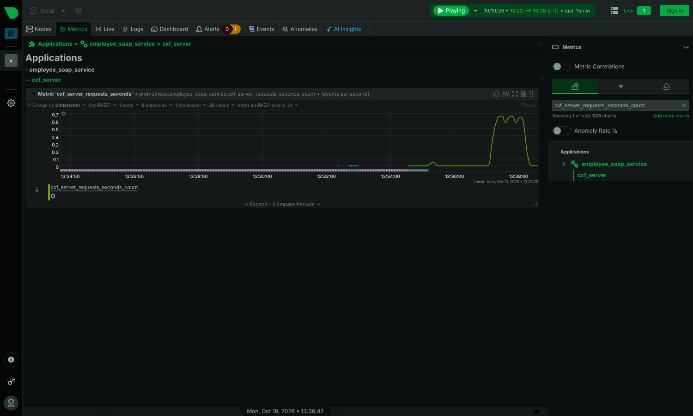

# Supervision avec Netdata

Netdata tourne dans le conteneur `es-netdata` et son tableau de bord est accessible sur **http://localhost:19999**.

## Ce qui est collecté

| Source | Configuration | Exemples de graphiques |
|---|---|---|
| Hôte et conteneurs Docker | automatique (`/proc`, `/sys`, socket Docker) | CPU, mémoire, réseau, disque par conteneur `es-*` |
| MySQL (base source) | `netdata/go.d/mysql.conf`, utilisateur `netdata` | requêtes/s, connexions, verrous InnoDB |
| PostgreSQL (base de référence) | `netdata/go.d/postgres.conf`, rôle `pg_monitor` | transactions, connexions, taille et activité des tables `employee`, `employee_changes` |
| Service SOAP | `netdata/go.d/prometheus.conf` → `http://employee-service:8080/actuator/prometheus` | `cxf_server_requests_seconds` par opération et par résultat (succès, Fault), JVM, pool de connexions Hikari |

Les métriques SOAP sont produites par la fonctionnalité `MetricsFeature` d'Apache CXF et Micrometer. Chaque appel est étiqueté avec `operation` (getEmployeeDetails, createEmployee, updateEmployee), `outcome`, `exception` (ex. `ValidationFault`) et la durée.

Dans le tableau de bord, chercher **prometheus_employee_soap_service** dans le menu de droite, puis les graphiques `cxf_server_requests_seconds_count`.

## Alerte

`netdata/health.d/employee_service.conf` définit l'alerte **employee_soap_service_injoignable** : elle passe en **CRITICAL** si la collecte des métriques du service échoue pendant 30 secondes (service arrêté ou planté), et revient à **CLEAR** quand il répond de nouveau. Vérifié en arrêtant le conteneur `es-service`.

```bash
curl -s "http://localhost:19999/api/v1/alarms?all" | grep employee_soap_service_injoignable
```

## Installation hors Docker

Sur une machine Linux sans Docker : `bash <(curl -Ss https://get.netdata.cloud/kickstart.sh)`, puis copier les fichiers de `netdata/go.d/` dans `/etc/netdata/go.d/` et `netdata/health.d/` dans `/etc/netdata/health.d/` en remplaçant les noms d'hôtes `mysql`, `postgres` et `employee-service` par `localhost`, et redémarrer avec `sudo systemctl restart netdata`.


